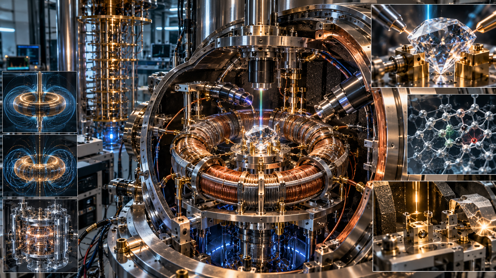
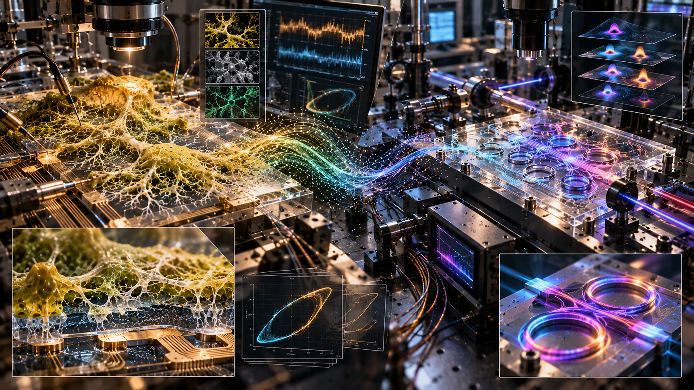

# LIFENODE --- PHASE I

## Modular Engineering and Validation Framework

**Version:** 0.4 --- Working Draft\
**Date:** 11 October 2026\
**Author:** Krzysztof Baran / LifeNode Research Collective\
**License:** CC-BY-NC-SA 4.0\
**Status:** Research and engineering roadmap; proposed targets are not
claims of demonstrated performance\
**Primary implementation repository:**
[LifeNode777/PHASE_1](https://github.com/LifeNode777/PHASE_1)\
**Theory and public-facing context:**
[LifeNode_2.5_Public](https://github.com/LifeNode777/LifeNode_2.5_Public)

------------------------------------------------------------------------

## 0. Executive Summary

PHASE I is the engineering and applications layer of LifeNode. It
translates selected constructions from the wider LifeNode ecosystem into
modular research questions, testable specifications, implementation
paths, and explicit failure conditions.

LifeNode is not a single device, paper, or hypothesis. It is a broader
research ecosystem spanning conceptual architecture, mathematical
constructions, software, experimental work, open research protocols, and
a narrative layer. PHASE I addresses a specific question within that
ecosystem:

> **What can be tested, implemented, or falsified next---and what
> evidence would justify moving to the next stage?**

The central architectural orientation is **PROCESS \> STATE**:
investigate systems through their dynamics, trajectories, phase
relationships, histories, and changing relations, rather than relying
only on isolated static measurements. This is a research orientation,
not a blanket claim that every process requires a trajectory-based model
or that a particular LifeNode construction is already validated.

PHASE I is organized around independently adoptable modules:

-   **A --- Bio-Electric Transduction**
-   **B --- MOF / Chemical-Optical Transduction**
-   **C --- Q-Core L2**
-   **D --- UNIT 02 Biohybrid Interface**
-   **E --- ASCALON Hardware**
-   **F --- Living Walls**
-   **G --- Zero-Build Validation**
-   **H --- Optional Metasurface / Trajectory-Filter Extension**
    (proposed extension; not part of the current A--G root structure of
    the PHASE_1 repository)

The principal low-cost entry point is Module G. It can test whether
selected trajectory-based constructions add measurable value on suitable
public data before hardware investment is considered. It cannot, by
itself, validate every module or establish the truth of the LifeNode
worldview as a whole.

The intended development pattern is:

**Theory and definitions → explicit construction → implementation → data
→ baseline comparison → falsification or validation → independent
reproduction → engineering integration.**

PHASE I does not promise a finished product, clinical capability,
space-qualified technology, or a predetermined positive result. Negative
and inconclusive results are legitimate outputs and must be preserved.

------------------------------------------------------------------------

## 1. Scope, Status, and Epistemic Boundaries

### 1.1 What this document is

This document is a modular engineering roadmap for independent
researchers, specialist laboratories, open-research contributors, and a
possible future research consortium. It records proposed module goals,
interfaces, parameter targets, dependencies, and falsification
requirements.

Each module should be understandable and, where feasible, testable
without requiring the contributor to accept the entire LifeNode
framework. A result for one module must not automatically be treated as
a result for another.

### 1.2 What this document is not

This document is not:

-   evidence that all proposed material stacks or device architectures
    have been built;
-   a claim that listed TRL estimates have been independently audited;
-   a clinical protocol, diagnostic method, or treatment recommendation;
-   evidence that a proposed biological, quantum, topological, or
    electromagnetic mechanism exists merely because it has been
    specified;
-   a costed implementation contract or guarantee of delivery;
-   a claim that one successful experiment validates the whole LifeNode
    framework.

Numerical values in module sections are **proposed design targets,
acceptance criteria, or hypotheses** inherited from the current planning
documents unless a result is explicitly linked to reproducible data and
a documented run. Their presence here does not imply that they have been
experimentally achieved.

### 1.3 Epistemic labels

Contributors should keep the following categories distinct in
documentation, code, presentations, and reports:

1.  **Observation** --- a recorded signal, measurement, or source
    result.
2.  **Established formalism** --- a method or theory with an independent
    technical basis.
3.  **LifeNode construction** --- a particular model, definition,
    mapping, or implementation proposed within LifeNode.
4.  **Hypothesis** --- a claim that yields a testable prediction.
5.  **Interpretation** --- an explanation assigned to an observation or
    result.
6.  **Speculation** --- a possibility not yet supported by adequate
    evidence.
7.  **Validated result** --- a result that passed a stated test and can
    be independently reproduced within the declared scope.

A result should never be promoted from hypothesis to validated result
merely because it is consistent with the LifeNode interpretation.

### 1.4 Modularity and negative results

A researcher may work on one module without endorsing the others. A
module may fail while other modules remain viable. A negative result
must be reported with the same care as a positive result, including
failed configurations, exclusions, parameter choices, and deviations
from the planned method.

------------------------------------------------------------------------

## 2. Architectural Principles

### 2.1 PROCESS \> STATE

The project prioritizes the study of dynamic organization: trajectories,
phase, rhythm, history, coupling, coherence, transitions, and change.
Static features remain useful as baselines and controls. The purpose is
to test whether process-sensitive representations add explanatory or
predictive value in a specific task---not to assume that they always do.

### 2.2 BIOS / INFO / META

The wider LifeNode ecosystem can be read through three interacting
layers:

-   **BIOS** --- physical and biological processes, substrates,
    measurements, and experimental conditions.
-   **INFO** --- representations, models, algorithms, code, simulations,
    agents, and trajectory-execution pipelines.
-   **META** --- interpretation, meaning, system-level orientation, and
    decisions about what should be investigated next.

These layers interact but are not interchangeable. A META-level
interpretation is not a substitute for BIOS measurements; a software
result is not a physical demonstration; and a physical signal does not
automatically establish a particular interpretation.

### 2.3 No ADC in the feedback loop --- a testable design constraint

Several proposed modules aim to preserve continuous or phase-sensitive
coupling without an analogue-to-digital converter (ADC) in the relevant
feedback path. This is an architectural requirement for those designs,
not a universal statement that digitization always destroys coherence.

Every implementation must define precisely which signal path is meant,
where measurement or logging occurs, what is considered feedback, and
how the analogue and digital comparison arms are matched.
Instrumentation used for observation must not silently become part of
the controlled feedback path.

### 2.4 Independent falsifiability

Each module must define:

-   the claim being tested;
-   the observable endpoint;
-   the operating envelope;
-   the control and null conditions;
-   the baseline;
-   the metric and analysis method;
-   the failure threshold;
-   the required metadata and provenance;
-   the next step after a positive, negative, or inconclusive result.

A proposed mechanism should be separated from the measurable function it
is intended to produce. For example, a sensor may detect a signal
without confirming the proposed explanation for that signal.

### 2.5 Baselines before complexity

Whenever feasible, compare a LifeNode-specific method against simpler
explanations and established baselines. Depending on the task, these may
include raw-signal features, linear models, conventional statistical
models, shuffled or phase-randomized controls, surrogate data,
ablations, and instrument-only controls.

If a simpler method explains the result equally well, that is a
substantive finding. The project should not treat added mathematical
complexity as evidence of added explanatory power.

------------------------------------------------------------------------

## 3. Development Model: Swarm → Evidence → Consortium → Hardware

PHASE I has two complementary operating modes.

### 3.1 Open-entry research swarm

The swarm is the decentralized, low-cost entry layer. It is designed for
independent researchers, software contributors, students, and people
working with public datasets or accessible instruments.

Typical activities include:

-   Module G Zero-Build analysis;
-   public-data replication and null-model testing;
-   simulation and sensitivity analysis;
-   small component-level or coupon-level experiments;
-   independent review of specifications and code;
-   provenance, telemetry, and audit work;
-   publication of negative or inconclusive results.

The swarm is not expected to reproduce cleanroom fabrication, advanced
cryogenics, radiation testing, or spaceflight demonstrations using
improvised equipment.

### 3.2 Evidence threshold and transition gate

A transition to infrastructure-intensive work should be evidence-driven,
not based on enthusiasm or conceptual alignment alone. The current
planning concept proposes a "Rubicon" gate that may include:

1.  an independently replicated Module G result with a clearly defined
    scope;
2.  positive, interpretable bench- or coupon-level results from at least
    two relevant modules, preferably produced by independent teams or
    laboratories;
3.  publication and review of negative results and known failure modes;
4.  documented methods, materials, code versions, parameters, and data
    provenance;
5.  a realistic next experiment with an identified facility requirement
    and decision criterion.

These are proposed governance criteria, not a claim that the gate has
already been passed. The exact acceptance rules should be preregistered
for the relevant work package.

### 3.3 Infrastructure-capable consortium

The consortium layer is intended for tasks requiring specialized
facilities, including some combination of:

-   cleanroom processing and microfabrication;
-   CVD diamond growth or specialist NV-center characterization;
-   cryogenics and superconducting systems;
-   MOF synthesis and advanced spectroscopy;
-   non-Hermitian photonics and precision optical measurements;
-   vacuum, radiation, and microgravity simulation;
-   long-duration biological-material stability studies;
-   access to aerospace testing or flight infrastructure.

Potential institutions listed in earlier planning documents are examples
of capability categories, not confirmed partners, endorsements, or
commitments. No institution should be represented as participating
without explicit confirmation.

### 3.4 Integration is earned

A module that passes its own bench test is not automatically ready for
integration. Integration requires interface definitions, compatible
operating envelopes, cross-module controls, and a new test plan. A
module can be useful independently even if another module is delayed or
abandoned.

------------------------------------------------------------------------

## 4. Shared Validation and Reproducibility Protocol

Every experimental or computational work package should maintain the
following record.

### 4.1 Minimum experiment record

-   **Run ID** and date/time, including timezone where relevant.
-   **Claim under test** and preregistered prediction.
-   **Source and data provenance**, including dataset release or
    instrument identifier.
-   **Code and configuration versions**, commit hashes, dependencies,
    and environment.
-   **Parameters and random seeds**, where applicable.
-   **Inclusion/exclusion rules** and all preprocessing steps.
-   **Baseline and null models**, selected before inspecting final test
    results where feasible.
-   **Metrics and statistical analysis plan.**
-   **Raw data location**, processed outputs, and checksums/hashes where
    feasible.
-   **Deviations, failures, warnings, and missing data.**
-   **Result classification:** positive, negative, inconclusive, or not
    executable.
-   **Reproduction instructions** and independent-run status.

### 4.2 Telemetry and audit trail

The PHASE_1 documentation includes a dedicated telemetry direction.
Telemetry should make the evolution of the research process observable:
what changed, when it changed, which run used which code, and how a
conclusion follows from the recorded evidence.

Telemetry is not just a presentation of activity statistics. It is a
structured record of execution and provenance. Screenshots or summary
statistics may be useful inputs, but they must not be treated as
equivalent to raw machine-readable measurements.

The project's `docs/Telemetry` materials and the Auditable Epistemic
Relay approach should be used where applicable. AI systems may assist
with extraction, analysis, and review, but their output must remain
traceable to source evidence. An AI-generated report is not independent
replication.

### 4.3 Nulls, controls, and leakage

At minimum, consider:

-   instrument and acquisition controls;
-   shuffled-label or shuffled-time controls where appropriate;
-   phase-randomized or surrogate-series controls where methodologically
    valid;
-   ablations of the proposed trajectory-specific component;
-   simpler baseline models;
-   checks for data leakage, repeated-subject leakage, and temporal
    leakage;
-   sensitivity to window length, embedding parameters, thresholds, and
    missingness.

A null model must preserve the relevant properties needed for the
question. A poorly chosen null does not establish the proposed mechanism
merely because the method outperforms it.

### 4.4 Reproduction and version discipline

No result should be described as reproduced unless an independent
execution used a declared method and its own recorded outputs. Changes
to scripts, definitions, metrics, or preprocessing must be logged. Do
not silently replace a failed method with a modified one and report the
combined history as one successful run.

For simulation modules, separate calibration from validation. A
calibration result is not a validation result. For Module H in
particular, calibration and expected-result checks must be documented
before more expensive propagation or metasurface validation runs.

------------------------------------------------------------------------

## 5. Module A --- Bio-Electric Transduction

**Role:** BIOS-facing transduction of biological electrical activity.\
**Status:** Proposed material and measurement architecture; performance
targets require experimental verification.

### 5.1 Objective

Investigate whether low-amplitude electrical signals associated with
biological substrates---including *Pleurotus ostreatus* mycelium and
cyanobacterial bio-photovoltaic (BPV) systems---can be acquired with
adequate signal-to-noise ratio while preserving the phase or temporal
properties relevant to the specific hypothesis.

The planning documents identify signal ranges of approximately 0.1--1 mV
DC for mycelial signals and 0.5--5 mV DC for cyanobacterial BPV signals.
These are planning ranges, not guaranteed properties of every specimen
or setup. The proposed K1/K2 motifs require an operational definition
and a reproducible detection protocol before they can be used as
acceptance endpoints.

### 5.2 Proposed material stack

  -----------------------------------------------------------------------
  Layer / component       Proposed specification  Intended role
  ----------------------- ----------------------- -----------------------
  Substrate               Z-cut synthetic quartz  Thermal stability and
                                                  optical transparency

  Active layer            LiNbO₃ with nanodiamond Proposed piezoelectric
                          loading (30% in the     / NV-related functional
                          current draft)          layer

  Electrodes              ITO                     Transparent conductive
                                                  contacts

  Electrode geometry      Logarithmic spiral;     Proposed
                          golden-ratio parameter  geometry-dependent
                          and 137.5° angle in the noise filtering
                          current design          

  Readout                 Lock-in amplifier       Low-amplitude signal
                          referenced to a defined extraction
                          biological rhythm or    
                          external reference      
  -----------------------------------------------------------------------

The functional contribution of each material and the proposed geometry
must be isolated experimentally. A geometric ratio alone is not evidence
of improved filtering.

### 5.3 Proposed operating targets

-   Signal range to investigate: 0.1--15 mV DC.
-   Proposed bandwidth: 0.0001 Hz--4 Hz.
-   Proposed input-referred noise target: below 50 nV/√Hz.
-   Preserve the declared feedback-path constraint: no ADC in the
    relevant feedback loop.
-   Proposed thermal operating range: 20--40°C for at least 72 hours.

The exact measurement bandwidth, noise definition, reference method,
grounding, shielding, and electrode configuration must be declared in
the protocol.

### 5.4 Failure conditions

The current design is not supported if a preregistered test shows any of
the following:

1.  The operationally defined K1/K2 patterns cannot be detected at the
    proposed SNR target of at least 20 dB in the specified test
    conditions.
2.  The analogue feedback configuration fails its declared
    phase-sensitive endpoint or performs no better than a properly
    matched digitized control where phase preservation is the claim
    under test.
3.  The setup fails the proposed 20--40°C, 72-hour stability
    requirement.
4.  The apparent biological signal is adequately explained by electrode
    drift, environmental interference, instrumentation artefacts, or a
    non-biological control.

### 5.5 Required next evidence

First establish a stable measurement baseline using biological and
non-biological controls. Then compare the proposed active stack and
electrode geometry against simpler reference configurations. Publish raw
traces, noise characterization, environmental conditions, and the
operational definition of every detected motif.

------------------------------------------------------------------------

## 6. Module B --- MOF / Chemical-Optical Transduction

**Role:** Proposed conversion of chemical exposure into an optical
phase-sensitive signal.\
**Status:** Proposed materials integration; end-to-end performance is
unverified.

### 6.1 Objective

Investigate a chain in which volatile organic compound
exposure---ethylene is the named example---changes the response of a
metal-organic framework (MOF), modulates an optical field in a D-shaped
fibre, and produces a measurable phase shift. Any further link from
optical phase to NV-spin response must be tested as a separate
interface.


### 6.2 Proposed material stack

  -----------------------------------------------------------------------
  Component               Proposed specification  Intended role
  ----------------------- ----------------------- -----------------------
  Pre-filter              MOF-525                 Proposed molecular
                                                  selection

  Signalling layer        MOF-74(Zn)              Proposed response to
                                                  VOC exposure

  Shape-memory /          DUT-8(Ni)               Proposed structural
  hysteretic layer                                hysteresis

  Optical interface       D-shaped fibre, nominal Evanescent-field
                          4 μm core in the        interaction
                          current draft           

  Nonlinear stage         Rubidium vapour cell    Proposed nonlinear
                                                  optical stage
  -----------------------------------------------------------------------

The roles of the MOFs, selectivity, hysteresis, and coupling to the
optical readout must be measured rather than inferred from the material
names. A hysteresis loop is not automatically evidence of memristive
behaviour; the test must rule out ordinary lag, thermal effects, and
instrument artefacts.

### 6.3 Proposed operating targets

-   Proposed refractive-index change: Δn ≥ 10⁻⁴.
-   Proposed interaction length: 10--50 mm.
-   Proposed wavelength in the current draft: 432 nm.
-   Phase shift relation to be evaluated:

\[
`\Delta `{=tex}`\phi`{=tex}(t)=`\frac{2\pi}{\lambda}`{=tex}`\int`{=tex}\_0\^L
`\Delta `{=tex}n(z,t),dz \]

The wavelength, material compatibility, optical losses, measurement
precision, and suitability of the nonlinear stage must be established
for the actual implementation.

### 6.4 Failure conditions

1.  Ethylene at or above 1 ppm is not detected at the proposed SNR
    target of 15 dB under the declared test conditions.
2.  The system fails the proposed 15--35°C, 48-hour stability
    requirement.
3.  The proposed DUT-8(Ni) hysteresis is not reproducible or is
    explained by a simpler mechanism.
4.  The optical response does not distinguish ethylene exposure from
    relevant interferents and environmental changes.

### 6.5 Required next evidence

Characterize each material separately, then test the optical coupling
with known concentration steps, blanks, interferents, and repeated
cycles. Only after these stages pass should the complete
MOF-to-optical-to-spin chain be assessed.

------------------------------------------------------------------------

## 7. Module C --- Q-Core

**Role:** Proposed spin-based subsystem for storing or representing
selected BIOS-related dynamics.\
**Status:** High-infrastructure research concept; integration claims
remain to be demonstrated.

### 7.1 Objective

Investigate whether NV centres in diamond can provide the intended
spin-state response to a defined input signal under the proposed
operating conditions, and whether the proposed toroidal/superconducting
assembly can meet independently measurable field and stability targets.

The existence of NV sensing technology does not itself validate the
proposed Q-Core architecture or the claimed coupling from a biological
signal to spin orientation.

### 7.2 Proposed component stack

  -------------------------------------------------------------------------
  Component               Current planning          Intended role
                          specification             
  ----------------------- ------------------------- -----------------------
  Diamond                 CVD \[111\], Ø25 mm, ¹⁵N  Spin-bearing substrate
                          implantation, target NV   
                          density 5 ppm             

  Toroidal coil           YBCO, 500 turns, stated   Proposed toroidal field
                          target (I_c=200) A at 77  generation
                          K                         

  Flux-lock elements      Gold, 999.9 purity,       Proposed stabilization
                          nominal Ø28/32/36 mm      geometry

  Magnetic shielding      Mu-metal, stated          Reduce external
                          (`\mu`{=tex}\>50{,}000)   magnetic interference

  Cooling                 Hybrid cryogenic          Thermal operating
                          arrangement, proposed 93  environment
                          ± 4 K                     
  -------------------------------------------------------------------------

All material, current, temperature, geometry, and safety specifications
require engineering review before fabrication. They should not be
treated as a complete manufacturing specification.

### 7.3 Proposed operating targets

-   Spin coherence time (T_2 `\geq 1`{=tex}) ms at the declared
    operating temperature.
-   Continuous operation for at least 24 hours at the target
    performance.
-   Proposed spin-response fidelity ≥ 0.90 for a defined input and
    readout task.
-   Proposed dipole-radiation suppression ≥ 20 dB for the claimed
    anapole configuration.
-   Preserve the specified no-ADC/DAC feedback-path constraint where the
    architecture requires it.

"Fidelity" must be defined against a reference state, estimator, and
uncertainty model. Dipole suppression must be measured against a
declared reference geometry and calibrated setup.

### 7.4 Failure conditions

The module fails its declared target if:

1.  (T_2) does not meet the preregistered threshold for the specified
    duration.
2.  The proposed input-to-spin response is not distinguishable from
    controls or does not meet the predefined fidelity target.
3.  The claimed toroidal/anapole field signature or dipole suppression
    is not observed with appropriate calibration and independent field
    characterization.
4.  Results depend on uncontrolled thermal, electromagnetic, or
    measurement artefacts.

### 7.5 Required next evidence

Begin with component-level NV characterization and a complete
electromagnetic model. Test field geometry and suppression separately
from biological coupling. Integrate only after each subsystem has a
reproducible baseline and interface specification.

------------------------------------------------------------------------

## 8. Module D --- UNIT 02 Biohybrid Interface

**Role:** Proposed biohybrid interface combining living material and
conducting polymer.\
**Status:** Conceptual and engineering specification; no medical or
field-use capability is implied.

### 8.1 Objective

Investigate a Physarum--PEDOT:PSS interface and its potential use as a
biohybrid electrochemical or memristive element. The current planning
concept also includes a crystalline core, a spiral
resonator/metamaterial, mycelial probes, and a haptic interface.

The existence of hysteresis or an electrical response does not by itself
establish a living transistor, a clean anapole field, or a useful
interface with Q-Core. Each claim requires its own measurement.

### 8.2 Proposed component stack

  -----------------------------------------------------------------------
  Component               Current planning        Intended role
                          specification           
  ----------------------- ----------------------- -----------------------
  Bio-crystalline core    Quartz (SiO₂) plus      Proposed resonant
                          amethyst with stated    structure
                          Fe³⁺ content of 3.7%    

  Tonic-field generator   Multilayer spiral       Proposed 10--100 kHz
                          resonator plus          field
                          metamaterial            

  Analogue-organic bridge *Physarum               Proposed OECT-like /
                          polycephalum* +         biohybrid interface
                          PEDOT:PSS               

  Mycelial probes         Eight biocompatible     Proposed biological
                          polymer probes, nominal coupling
                          300 mm, spaced at 45°   

  Haptic array            Multilayer              Operator feedback
                          piezoelectric structure 
  -----------------------------------------------------------------------

These dimensions and material claims are inherited design proposals and
require compatibility, safety, and feasibility review.

### 8.3 Proposed operating targets

-   Proposed core resonance band: 0.5--150 Hz.
-   Proposed carrier range: 10--100 kHz, with 0.001--0.1 Hz modulation.
-   Reproducible electrical hysteresis under a declared measurement
    protocol.
-   Proposed biological viability target: at least three months under
    the specified test environment. The earlier draft also mentions a
    six-month material-stability target; the two durations should be
    assigned to distinct endpoints rather than merged.

### 8.4 Failure conditions

1.  The Physarum--PEDOT:PSS bridge does not exhibit reproducible,
    control-separated hysteresis under the preregistered protocol.
2.  The proposed toroidal/anapole signature and dipole suppression of at
    least 15 dB are not observed in calibrated measurements.
3.  The biological interface fails the predefined viability or stability
    criterion.
4.  Apparent behaviour can be explained by passive circuit effects,
    electrode polarization, dehydration, temperature drift, or other
    non-specific effects.

### 8.5 Required next evidence

Separate biological viability, polymer conduction, hysteresis, field
generation, and integrated-interface tests. Use non-living,
polymer-only, and biological-only controls. Avoid describing the device
as a field-ready interface until long-duration stability and independent
replication are available.

------------------------------------------------------------------------

## 9. Module E --- ASCALON Hardware

**Role:** Proposed physical implementation of a
trajectory/phase-sensitive filter using non-Hermitian photonics.\
**Status:** Research concept; proposed threshold and safety behaviour
require calibration and validation.

### 9.1 Objective

Investigate whether a photonic system using PT-symmetric resonators or
exceptional-point-related behaviour can implement a specified filtering
or switching function tied to a well-defined trajectory metric
(`\theta`{=tex}).

The current design uses (`\theta `{=tex}`\geq 0.70`{=tex}) as a proposed
coherent-trajectory threshold and specifies a LOCKDOWN response when the
threshold is crossed. The value 0.70 is not a universal physical
constant. It must be operationally defined, calibrated for the intended
data and apparatus, and tested against alternatives.

### 9.2 Proposed architecture

  -----------------------------------------------------------------------
  Component                           Proposed function
  ----------------------------------- -----------------------------------
  PT-symmetric resonator array        Physical optical response /
                                      filtering

  Trajectory-metric estimator         Continuous or suitably sampled
                                      monitoring of the declared
                                      (`\theta`{=tex}) quantity

  LOCKDOWN controller                 Enter a defined safe state when a
                                      preregistered condition is met
  -----------------------------------------------------------------------

The metric estimator, physical filter, and safety controller must be
evaluated separately. A controller reacting quickly to an input does not
establish that the input is a valid predictor of a biological or
clinical event.

### 9.3 Proposed operating targets

-   Proposed critical threshold: (`\theta=0.70`{=tex}).
-   Proposed response time from declared threshold crossing to LOCKDOWN:
    under 1 second.
-   Proposed phase resolution: ±0.005 rad.
-   Proposed thermal stability: 20--40°C.

The implementation must specify how (`\theta`{=tex}) is computed,
normalized, filtered, and calibrated. If the formula does not
mathematically constrain (`\theta`{=tex}) to \[0,1\], the document and
implementation must not assume that range without an explicit
transformation and justification.

### 9.4 Failure conditions

1.  The apparatus does not enter the defined safe state within the
    proposed response time.
2.  The optical response is not reproducible across the specified
    operating range.
3.  The threshold has no stable relationship to the independently
    defined target endpoint, or its performance is matched by a simpler
    baseline.
4.  The system is vulnerable to false triggers, missed triggers, drift,
    or unsafe failure modes.

The earlier planning draft proposed a clinical lead-time test for
arrhythmia. That claim is **a separate, unvalidated biomedical
hypothesis**, not a hardware acceptance criterion by itself. Any such
evaluation would require prospective, blinded, ethically reviewed
research, an independent clinical endpoint, suitable sample size,
external validation, and explicit sensitivity, specificity,
false-positive rate, and calibration analysis. PHASE I must not present
ASCALON as a diagnostic or medical device on the basis of the current
specification.

### 9.5 Required next evidence

Validate the (`\theta`{=tex}) computation on offline data first. Then
validate the photonic response using non-clinical synthetic inputs. Test
LOCKDOWN with fault injection and worst-case timing. Only after those
stages should a justified, separately governed study of any biological
endpoint be considered.

------------------------------------------------------------------------

## 10. Module F --- Living Walls

**Role:** Long-horizon biohybrid habitat-material concept.\
**Status:** Exploratory space-environment research direction; not a
demonstrated habitat technology.

### 10.1 Objective

Investigate a proposed composite involving *Cladosporium
sphaerospermum*, PEDOT:PSS, Fe₃O₄, LiNbO₃, nanocellulose, and chitosan.
The long-term concept explores whether a biological/material wall can
provide useful functions in a space-habitat environment.

The proposed conversion of galactic cosmic-ray (GCR) exposure into a VLF
or "Earth-Sync" signal is a hypothesis requiring direct energy
accounting and instrumented tests. Evidence of fungal growth under
radiation, if observed in a particular experiment, would not by itself
demonstrate energy transduction into a useful VLF output.

### 10.2 Proposed material stack

  -----------------------------------------------------------------------
  Layer / component       Current planning        Intended role
                          specification           
  ----------------------- ----------------------- -----------------------
  Biological substrate    *Cladosporium           Proposed radiotrophic
                          sphaerospermum*         biological component

  Conductive additive     PEDOT:PSS               Proposed electrical
                                                  coupling

  Magnetic particles      Fe₃O₄                   Proposed magnetic
                                                  response

  Piezoelectric component LiNbO₃                  Proposed response to
                                                  mechanical
                                                  micro-vibration

  Matrix                  Nanocellulose +         Proposed composite
                          chitosan                substrate
  -----------------------------------------------------------------------

### 10.3 Proposed development ladder

1.  **Coupon level:** material compatibility, viability, conductivity,
    radiation-response characterization.
2.  **Panel level:** repeatability and spatial uniformity on a larger
    surface.
3.  **Environmental simulation:** vacuum, temperature cycling, radiation
    exposure, and clinostat or other justified microgravity analogues,
    with controls.
4.  **Pre-flight validation:** safety, contamination control,
    outgassing, mechanical integrity, and power/energy accounting.
5.  **Flight demonstration:** only after the preceding gates and
    appropriate institutional approvals.

The proposed targets in the earlier draft include a 12-month stability
period and a VLF transduction efficiency target of at least 5%. These
should be retained as hypotheses only if their numerator, denominator,
measurement bandwidth, controls, and operating conditions are explicitly
defined.

### 10.4 Failure conditions

1.  The specified biological response is not reproducible against
    non-radiation and non-biological controls.
2.  No measurable VLF output attributable to the proposed transduction
    pathway is found, or the measured energy budget contradicts the
    claim.
3.  The composite fails the predefined stability, viability, or
    mechanical requirements.
4.  Apparent output is explained by instrumentation, external
    electromagnetic coupling, thermal gradients, or another simpler
    source.

### 10.5 Required next evidence

Do not begin with a complete habitat wall. Establish each component's
contribution, conduct energy accounting, test radiation and
environmental controls, and publish negative results. Any spaceflight or
habitat claim must be supported by tests appropriate to the relevant
environment.

------------------------------------------------------------------------

## 11. Module G --- Zero-Build Validation

**Role:** Low-cost, software-first testing of selected mathematical and
trajectory-based LifeNode constructions.\
**Status:** Preferred entry point for falsifiable work; a positive
result validates only the tested claim and dataset.

### 11.1 Objective

Test whether trajectory reconstruction and related geometric or
topological features add robust, reproducible information beyond simpler
baselines on suitable public datasets. The current plan identifies
PhysioNet and the Eden Node 0 data path as potential inputs; each
dataset must be checked for actual availability, licensing,
documentation, sampling, and suitability before a run.

Module G is the primary way to investigate the mathematics before
committing to costly hardware. It is not a universal proof engine and
cannot validate the hardware modules by itself.


### 11.2 Proposed analysis pipeline

1.  **Dataset and endpoint definition**
    -   Specify the source, release, population or system, sampling
        rate, units, missingness, and target endpoint.
    -   Separate exploratory analysis from a held-out confirmatory test.
2.  **Preprocessing and signal-quality audit**
    -   Document filtering, resampling, segmentation, exclusions, and
        artifact handling.
    -   Avoid leakage across subjects, sessions, or time windows.
3.  **Phase-space reconstruction**
    -   Use delay embedding where justified.
    -   Select delay (`\tau`{=tex}) using a declared method, such as
        mutual information, and embedding dimension (m) using a declared
        criterion, such as false nearest neighbours.
    -   Report sensitivity to parameter choices rather than treating one
        selection as uniquely correct.
4.  **Trajectory and geometric descriptors**
    -   Estimate correlation dimension (D_2) where data length and
        stationarity assumptions support it.
    -   Estimate the largest Lyapunov exponent (`\lambda`{=tex}\_1) only
        where the method's assumptions and data quality make the
        estimate interpretable.
    -   Compute persistent homology and Betti summaries
        ((`\beta`{=tex}\_0,`\beta`{=tex}\_1,`\beta`{=tex}\_2)) with
        declared filtration, scaling, and stability choices.
    -   Compute (`\theta`{=tex}(t)) only from a versioned, explicit
        definition, including normalization, windowing, uncertainty, and
        missing-data behaviour.
5.  **Baseline comparison**
    -   Compare with appropriate pointwise and conventional baselines,
        which may include mean heart rate, peak amplitude, time-domain
        and frequency-domain features, and simple statistical or
        machine-learning models.
    -   Include relevant nulls, surrogate data, ablations, and leakage
        checks.
6.  **Statistical evaluation**
    -   Predefine metrics, uncertainty estimates, multiple-comparison
        handling, and the rule for selecting thresholds.
    -   Use held-out or external data where available.
    -   Report effect size and uncertainty, not only a p-value.

### 11.3 The (`\theta`{=tex}) threshold and lead-time claim

The existing planning documents propose (`\theta`{=tex}\<0.70) as a
possible trajectory-coherence threshold and discuss a possible
24--48-hour lead time for a clinical event, with a minimum six-hour
lead-time target in some acceptance criteria. These values are
**hypotheses to evaluate**, not established biomarkers or validated
predictive properties.

Before evaluating such a claim, the project must:

-   publish the exact (`\theta`{=tex}) formula and version;
-   demonstrate or explicitly define its range and normalization;
-   preregister window length, threshold, event definition, and
    lead-time logic;
-   prevent subject, temporal, and preprocessing leakage;
-   define sensitivity, specificity, positive predictive value,
    false-alarm rate, calibration, and lead-time distribution;
-   compare against simple baselines and appropriate null models;
-   reserve a genuinely held-out dataset or independent cohort for
    confirmation.

A target sample size such as (n`\geq100`{=tex}) is not automatically
adequate. Adequacy depends on event prevalence, effect size,
repeated-measure structure, and the planned statistical analysis.
Clinical claims require appropriate ethics and governance and must not
be inferred from an exploratory public-data run.

### 11.4 Failure conditions

The relevant LifeNode construction fails its stated test if any
preregistered primary condition occurs, including:

1.  The trajectory-specific method does not outperform the declared
    baseline on the primary metric.
2.  Its apparent performance disappears under appropriate nulls,
    ablations, or held-out evaluation.
3.  Results are unstable under reasonable changes in embedding
    parameters, window lengths, or preprocessing.
4.  The effect cannot be independently reproduced.
5.  The result depends on data leakage, post-hoc threshold selection, or
    selective reporting.

The earlier draft's proposed sensitivity floor of 60% may be retained as
a project target for a specific task, but it must be assessed together
with specificity, false positives, calibration, and the baseline.
Sensitivity alone is not sufficient evidence of usefulness.

### 11.5 Current implementation discipline

Module G should maintain a clear separation between:

-   mathematical definition;
-   implementation;
-   calibration;
-   exploratory result;
-   confirmatory result;
-   independent reproduction.

Any code path that is incomplete, stubbed, or not executed must be
labelled accordingly. A test result from one record is not cohort
evidence. A successful run on synthetic data verifies only the behaviour
tested by that synthetic design.

------------------------------------------------------------------------

## 12. Module H --- Optional Metasurface / Trajectory-Filter Extension

**Repository status:** Optional extension described in the accompanying
Phase 1 planning material; the current public PHASE_1 repository root
lists Modules A--G. Module H should not be represented as an implemented
root module until its repository status and artefacts are updated
accordingly.

**Role:** Proposed physical or simulated trajectory-sensitive optical
filtering / metasurface work.\
**Status:** Extension requiring staged calibration and validation.

### 12.1 Objective

Investigate a proposed metasurface or time-programmed optical system
using LiNbO₃ and a set of wave or soliton-related kernels designated
S1--S5. The intended purpose is to explore whether a physical optical
system can reproduce a declared transformation or selection behaviour
associated with a trajectory-processing construction.

The labels S1--S5 must map to explicit mathematical definitions, input
conditions, expected outputs, and measurable error metrics. The labels
alone do not define a validated physical effect.

### 12.2 Staged validation

1.  **Definition and calibration:** specify the kernels, apparatus
    model, units, expected results, and tolerances.
2.  **Numerical calibration:** compare the implementation against
    analytic cases or independently checked references.
3.  **Null and control runs:** include no-H/no-metasurface, shuffled or
    randomized inputs where appropriate, and simpler filtering
    baselines.
4.  **Simulation validation:** run the declared propagation method only
    after calibration checks pass.
5.  **Physical component tests:** measure fidelity, selectivity,
    temporal programmability, and repeatability.
6.  **Integration test:** compare the complete system against a matched
    control and report uncertainty.

Calibration outputs must not be presented as validation of the
metasurface. The expected-results record, methods notes, and metric
implementation should be versioned together. The project's existing H/L1
calibration materials---including `EXPECTED_RESULTS`, `METHODS_NOTES`,
and `peregrine_metrics.py` where applicable---should be treated as the
authoritative local artifacts for their declared scope. Changes to them
must be logged.

### 12.3 Proposed targets from the planning material

-   Output fidelity ≥ 0.90 under a clearly defined metric.
-   S2 selectivity ≥ 10 dB under a declared reference and measurement
    bandwidth.
-   Demonstrable temporal programmability.
-   A measurable difference between the proposed (`\theta`{=tex})
    condition and an appropriate no-H control.
-   Distinct K1/K2 signatures compared with suitable shuffled or null
    controls, if those signatures are operationally defined for this
    experiment.

These are proposed targets, not demonstrated performance.

### 12.4 Failure conditions

1.  The output does not meet the preregistered fidelity or selectivity
    threshold.
2.  Temporal programmability cannot be distinguished from static
    response or measurement artefact.
3.  The proposed method does not outperform the declared no-H or simpler
    baseline.
4.  The effect is not reproducible across independent runs or is
    sensitive to undocumented parameter changes.
5.  The required provenance, calibration, or null-model record is
    incomplete.

### 12.5 Dependencies

The extension may connect to A/B material or sensing work and may later
inform C/E investigations, but these connections are conditional. Module
H is not a prerequisite for the initial Zero-Build path and should not
delay independent progress on Module G.

------------------------------------------------------------------------

## 13. Module Dependencies and Critical Path

The proposed high-level path is:

**G → A/B → C → D/E → F**

Module H is an optional branch, not part of the mandatory critical path.

  -----------------------------------------------------------------------
  Module                  Main dependencies       Potential downstream
                                                  role
  ----------------------- ----------------------- -----------------------
  A --- Bio-Electric      Independent component   Candidate biological
                          and biological-signal   input to later
                          tests                   interfaces

  B --- MOF / Photonics   Material                Candidate
                          characterization and    chemical-optical input
                          optical baseline        

  C --- Q-Core L2         Relevant input          Proposed spin/field
                          interface plus          subsystem for D/E and
                          independent NV/field    later work
                          validation              

  D --- UNIT 02           Independent biohybrid   Candidate biohybrid
                          and interface tests;    application and later
                          possible C integration  habitat research

  E --- ASCALON Hardware  Defined                 Candidate
                          (`\theta`{=tex}),       trajectory-sensitive
                          validated computation,  physical filter
                          photonic and safety     
                          tests; possible C       
                          interface               

  F --- Living Walls      Independent material,   Long-horizon
                          biological, energy, and habitat-material
                          environmental tests;    research
                          later integration only  
                          if justified            

  G --- Zero-Build        Public or otherwise     Early test of selected
                          accessible suitable     mathematical
                          data; reproducible      constructions before
                          software                hardware

  H --- Optional          Explicit kernels,       Optional
  Extension               calibration, nulls,     optical/metasurface
                          simulation and          testbed
                          component tests         
  -----------------------------------------------------------------------

This table is a dependency hypothesis, not a claim that every downstream
module must use every upstream module. Modules should remain
independently useful where their research question permits.

------------------------------------------------------------------------

## 14. System-Level Falsification: Scope and Discipline

The previous planning draft listed several possible system-level
falsifiers: reduction to simpler feed-forward models, frequency-response
inversion, thermodynamic isolation of a proposed trajectory manifold,
and failure of (`\theta`{=tex}) to precede a target event. These ideas
should be retained as research questions only after their terms and
scope are made operational.

A single result should not be used to declare the entire LifeNode
ecosystem true or false. LifeNode contains distinct conceptual,
mathematical, engineering, experimental, and narrative layers; a
falsifier must target a clearly specified claim in one of those layers.

Candidate system-level tests include:

1.  **Added-value test:** a trajectory-based method fails to outperform
    an appropriate simpler baseline on a preregistered task and held-out
    data.
2.  **Robustness test:** a claimed effect disappears under valid nulls,
    parameter sensitivity checks, or independent replication.
3.  **Thermodynamic / dynamical test:** a proposed physical model
    contradicts measurements or established constraints under explicitly
    stated assumptions.
4.  **ASCALON relevance test:** the defined (`\theta`{=tex}) measure has
    no reproducible relationship to the independent endpoint for which
    it was proposed.
5.  **Cross-module interface test:** the proposed coupling between two
    modules cannot be measured above controls or does not satisfy the
    declared energy, timing, or signal budget.

These tests can falsify specific constructions or integration claims.
Broader ontological conclusions require separate arguments and evidence;
they do not follow automatically from a single module result.

------------------------------------------------------------------------

## 15. Consortium Competencies and Infrastructure Map

The following competency map is indicative. It does not imply that any
named institution has agreed to participate.

  -------------------------------------------------------------------------
  Research area           Relevant modules        Capability category
  ----------------------- ----------------------- -------------------------
  Biological              A, D, F                 Biological signal
  electrophysiology                               acquisition,
                                                  living-substrate
                                                  controls, viability

  Materials science and   A, C, D, F, H           LiNbO₃, ITO, nanodiamond,
  microfabrication                                composite fabrication

  MOF chemistry           B                       Synthesis,
                                                  adsorption/selectivity,
                                                  stability
                                                  characterization

  Fibre optics and        B, H                    Optical phase, evanescent
  spectroscopy                                    coupling, spectral and
                                                  noise characterization

  NV-centre physics and   C                       Diamond characterization,
  microwave engineering                           ODMR, spin coherence,
                                                  microwave control

  Superconductivity and   C                       YBCO, cryogenic
  cryogenics                                      integration, thermal and
                                                  electromagnetic safety

  Biohybrid systems       D, F                    Physarum, PEDOT:PSS,
                                                  OECT-related
                                                  measurements,
                                                  biological-material
                                                  stability

  Non-Hermitian photonics E, H                    PT-symmetric systems,
                                                  exceptional-point
                                                  characterization, optical
                                                  control

  Computational dynamics  G, E, H                 Delay embedding, (D_2),
  and topology                                    Lyapunov estimates,
                                                  persistent homology

  Statistics and          All                     Baselines, nulls,
  experimental design                             preregistration,
                                                  uncertainty, blinded
                                                  testing

  Space-environment       F                       Vacuum, radiation,
  testing                                         thermal cycling,
                                                  microgravity analogues,
                                                  flight qualification

  Software and research   G, H, all modules       Versioning, CI,
  infrastructure                                  telemetry, reproducible
                                                  pipelines, data
                                                  management
  -------------------------------------------------------------------------

Potential external nodes should be approached with a specific,
reviewable work package rather than a claim that they can or should
implement the entire ecosystem. The best first contact is a concrete
question, a defined endpoint, an honest statement of current evidence,
and a small experiment with a meaningful decision criterion.

------------------------------------------------------------------------

## 16. Repository and Work-Package Structure

Each active module should maintain a consistent minimum structure where
appropriate:

``` text
MODULE_X/
├── README.md
├── SPEC.md
├── FALSIFICATION.md
├── LOG.md
├── docs/
├── sim/
├── data/
└── img/
```

Not every folder must contain files from day one. Do not create
placeholder artefacts merely to make the tree look complete. Data should
only be committed where licensing, size, privacy, and repository policy
permit; otherwise provide durable source references and reproducible
acquisition instructions.

### 16.1 README.md

Describe the module's purpose, current status, prerequisites, and
fastest reproducible entry point. Clearly separate implemented
components from proposed ones.

### 16.2 SPEC.md

Define the claim, system boundary, interfaces, parameters, units,
operating envelope, assumptions, and acceptance criteria. Every
threshold must have a stated measurement procedure.

### 16.3 FALSIFICATION.md

State what result would count against the module's primary claim, what
nulls and baselines are required, and what result would be inconclusive.
Include conditions under which the experiment should not be run.

### 16.4 LOG.md

Record changes in definitions, code, parameters, experimental decisions,
failed runs, and interpretation. Link each reported result to its run
record and exact version.

### 16.5 Telemetry and provenance

Store standardized run records in the applicable telemetry location.
Preserve enough information to reconstruct which source data, code,
configuration, and metrics produced a reported result. Hashes are useful
only when the corresponding artefact can be located and accessed.

------------------------------------------------------------------------

## 17. Safety, Ethics, and Responsible Claims

-   Do not present an unvalidated research concept as a medical device,
    diagnostic system, treatment, or clinically predictive method.
-   Do not conduct human-subject research without the applicable ethics
    review, consent, governance, and data protections.
-   Define safe operating limits before working with high currents,
    cryogens, lasers, chemical materials, radiation sources, biological
    cultures, or vacuum systems.
-   For living materials, specify containment, disposal, contamination
    control, and viability criteria.
-   For space-related concepts, do not infer flight readiness from a
    laboratory demonstration or an analogue environment.
-   Report failed and negative results, including unexpected adverse
    effects.
-   Do not use AI-generated interpretations as a replacement for source
    data, qualified review, or independent replication.

------------------------------------------------------------------------

## 18. Near-Term Priorities

The recommended sequence is deliberately staged.

### Priority 1 --- Make Module G auditable

-   Freeze a versioned definition of every primary metric, including
    (`\theta`{=tex}).
-   Identify which code paths are complete, stubbed, exploratory, or
    validated.
-   Establish dataset provenance, preprocessing, and held-out
    evaluation.
-   Add simple baselines, suitable nulls, and sensitivity analysis.
-   Preserve run records, hashes, and negative results.

### Priority 2 --- Reproduce before expanding

-   Repeat the smallest meaningful experiment with a fixed protocol.
-   Separate calibration from confirmation.
-   Ask an independent reviewer or executor to reproduce the run from
    the documented artefacts.
-   Treat disagreement between independent runs as information requiring
    diagnosis, not as a reason to select the preferred result.

### Priority 3 --- Choose one component-level physical test

Select the smallest A/B/C/D/E/F test that has a measurable output,
accessible controls, and a clear decision rule. Avoid beginning with a
fully integrated system when component-level evidence is missing.

### Priority 4 --- Define an evidence gate for consortium work

Use the recorded outcomes from G and any completed component tests to
identify the next infrastructure requirement. A consortium proposal
should state what has already been measured, what remains hypothetical,
what facility is needed, and what result would justify continuing.

### Priority 5 --- Keep optional branches optional

Module H and the longer-horizon Living Walls pathway can develop in
parallel when suitable contributors and resources exist, but they should
not block the low-cost validation path.

------------------------------------------------------------------------

## 19. Decision Rules and Result Categories

Every work package should end in one of four categories:

-   **Positive within scope:** the preregistered endpoint met its
    criterion against the declared controls and baselines.
-   **Negative within scope:** the endpoint failed its criterion, or the
    proposed effect was not distinguishable from controls.
-   **Inconclusive:** data quality, power, instrumentation, or protocol
    deviations prevent a justified conclusion.
-   **Not executed:** the test was not run or the implementation was
    incomplete.

A positive result is bounded by its dataset, apparatus, conditions, and
analysis. It does not automatically transfer to other biological
systems, hardware, clinical outcomes, or theoretical claims.

The next action should follow from the result category. A negative
result may close a path, refine a definition, or motivate a different
experiment. An inconclusive result calls for a specific diagnosis of
uncertainty. A positive result calls for replication and scope
expansion---not immediate claims of general validity.

------------------------------------------------------------------------

## 20. Closing Principle

PHASE I is not an attempt to prove LifeNode by declaration. It is an
attempt to turn selected parts of a broad process-oriented research
ecosystem into inspectable constructions and experiments whose outcomes
can constrain what the project claims next.

The governing sequence is:

**Idea → Formalization → Implementation → Data → Baseline → Test →
Falsification / Validation → Reproduction → Engineering.**

The swarm makes entry and independent scrutiny possible. Telemetry and
provenance preserve the path from evidence to conclusion. The consortium
becomes relevant when a clearly defined result requires infrastructure
that the swarm cannot reasonably supply. Hardware integration follows
evidence; it does not substitute for it.

**Process \> State. Evidence before integration. Reproduction before
escalation.**

---
---

📄 [LIFENODE — Phase I Requirements Framework (Pre-TRL 3 → TRL 4)]
A modular engineering specification that translates the LifeNode theory into a set of independently falsifiable R&D modules (A–G). The document defines hard boundary conditions, material stacks, and precise failure criteria for bio-digital transduction, the quantum core, non-Hermitian optics (ASCALON), and mathematical Zero-Build validation.
It serves as an open implementation plan for independent researchers, transdisciplinary teams, and specialized R&D laboratories.

# LIFENODE - ZARYS WYMAGAŃ DLA FAZY PIERWSZEJ 

## *Dokument roboczy - moduły niezależnie falsyfikowalne*

**Wersja:** 0.2 (Draft)  
**Data:** 1 sierpnia 2026  
**Autor:** Krzysztof Baran / LifeNode Research Collective  
**Licencja:** CC-BY-NC-SA 4.0  
**Status:** Pre-TRL 3 → TRL 4 roadmap  
**Kontakt:** krzysiek_230@op.pl  

---

## 1. ZAŁOŻENIA DOKUMENTU

Niniejszy szkic jest **zbiorem falsyfikowalnych specyfikacji modułowych** dla teoretycznego przyszłego konsorcjum (akademia + przemysł + fundusze), które podjęłoby próbę fizycznej implementacji architektury LifeNode. 

**Kluczowe zasady:**
- Każdy moduł (A-G) jest **niezależnie falsyfikowalny** — konsorcjum może pracować nad jednym modułem bez zobowiązania do pozostałych.
- **Brak wycen** — koszty nie do oszacowania na obecnym poziomie rozwoju technologicznego planety Ziemia. Wiadomo że w chuj duże. 🙃
- **Brak obietnic gotowego produktu** — Faza I ma na celu fizyczną walidację wybranych modułów w warunkach laboratoryjnych.
- Teoria LifeNode (NLSE, metryka Finslera, twierdzenie Takensa, ASCALON θ, sekwencje S1-S5) jest już sformalizowana matematycznie i opublikowana (Zenodo DOI, 2026).

---

## 2. MODUŁ A: TRANSDUKCJA BIO-ELEKTRYCZNA (LINIA 1)

### 2.1 Cel
Odczyt sygnałów elektrycznych grzybni (0.1–1 mV DC, motywy K1/K2) i sinic BPV (0.5–5 mV DC) z zachowaniem ciągłości fazowej (bez ADC w pętli sprzężenia).

### 2.2 Stack materiałowy
| Warstwa | Materiał | Rola |
|---------|----------|------|
| Podłoże | Kwarc syntetyczny (cięcie Z) | Stabilność termiczna, przezroczystość UV |
| Warstwa aktywna | LiNbO₃ + nanodiamenty (30%) | Piezoelektryczność + centrum NV |
| Elektrody | ITO (Indium Tin Oxide) | Przezroczystość + przewodnictwo |
| Geometria elektrod | Spirala logarytmiczna (φ = 1.618, kąt 137.5°) | Pasywny filtr geometryczny szumu |

### 2.3 Parametry operacyjne
- **Zakres sygnału:** 0.1–15 mV DC
- **Pasmo:** 0.0001 Hz – 4 Hz (Macro- do Micro-BPB)
- **Szum własny:** < 50 nV/√Hz
- **Wzmocnienie:** Lock-in amplifier z referencją z naturalnego rytmu BIOS

### 2.4 Warunki falsyfikacji
Moduł A jest uważany za **nieudany**, jeśli:
1. Nie wykryje motywów K1/K2 w sygnale *Pleurotus ostreatus* z SNR ≥ 20 dB (walidacja: Adamatzky et al., bioRxiv 2026).
2. Wprowadzi dyskretyzację (ADC) w pętli sprzężenia, co skutkuje utratą koherencji fazowej (θ spada poniżej 0.70 w teście porównawczym).
3. Nie utrzyma stabilności termicznej w zakresie 20–40°C przez ≥ 72h.

### 2.5 TRL i czas
- **Aktualny TRL:** 2 (teoria + symulacje)
- **Docelowy TRL po Fazie I:** 4 (walidacja w laboratorium)

### 2.6 Potrzebne kompetencje
- Fizyka materiałów (LiNbO₃, ITO)
- Mikrofabrykacja (cleanroom, litografia)
- Elektrofizjologia grzybni (Adamatzky group, UWE Bristol)
- Projektowanie lock-in amplifiers

---

## 3. MODUŁ B: TRANSDUKCJA CHEMICZNO-OPTYCZNA (LINIA 2 — MOF)

### 3.1 Cel
Odczyt lotnych związków organicznych (LZO, np. etylen jako marker stresu roślin) poprzez zmianę objętości MOF → modulację współczynnika załamania światła w światłowodzie D-shaped → przesunięcie fazowe fotonu → rotacja spinów NV.

### 3.2 Stack materiałowy
| Warstwa | Materiał | Rola |
|---------|----------|------|
| Filtr wstępny | MOF-525 | Selekcja cząsteczek > 1 nm |
| Warstwa sygnalizacyjna | MOF-74(Zn) (kanały sześciokątne S3) | "Oddychanie" pod wpływem LZO |
| Warstwa pamięci kształtu | DUT-8(Ni) | Shape-memory, histereza |
| Światłowód | D-shaped fiber (rdzeń 4 μm) | Evanescent field interaction |
| Nieliniowość saturująca | Para rubidu (komórka gazowa) | Stabilizacja solitonów S3 |

### 3.3 Parametry operacyjne
- **Czułość:** Δn ≥ 10⁻⁴ (zmiana współczynnika załamania)
- **Długość interakcji:** L = 10–50 mm
- **Długość fali lasera:** 432 nm (pompa NV)
- **Przesunięcie fazowe:** Δφ = (2π/λ) ∫₀ᴸ Δn(z,t) dz

### 3.4 Warunki falsyfikacji
Moduł B jest uważany za **nieudany**, jeśli:
1. Nie wykryje etylenu w stężeniu ≥ 1 ppm z SNR ≥ 15 dB.
2. Nie utrzyma stabilności termicznej MOF w zakresie 15–35°C przez ≥ 48h.
3. Nie wykaże histerezy memrystancyjnej w DUT-8(Ni) (pętla I-V z pamięcią kształtu).

### 3.5 TRL i czas
- **Aktualny TRL:** 2 (synteza MOF w laboratoriach akademickich)
- **Docelowy TRL po Fazie I:** 4 (integracja ze światłowodem)

### 3.6 Potrzebne kompetencje
- Chemia koordynacyjna (synteza MOF)
- Fotonika (światłowody D-shaped, EOM)
- Spektroskopia absorpcyjna (para rubidu)
- Chemia materiałów porowatych

---

## 4. MODUŁ C: RDZEŃ KWANTOWY (Q-CORE L2)

### 4.1 Cel
Magazynowanie rytmu BIOS jako orientacji spinów w centrach NV diamentu, bez dyskretyzacji ADC/DAC.

### 4.2 Stack materiałowy
| Komponent | Specyfikacja | Rola |
|-----------|--------------|------|
| Diament | CVD [111], Ø25 mm, ¹⁵N implantacja, NV 5 ppm | Nośnik spinów |
| Cewka toroidalna | YBCO, 500 zwojów, I_c = 200 A @ 77 K | Pole toroidalne |
| Flux Locks | Au 999.9, Ø28/32/36 mm, φ = 1.618 | Stabilizacja izosymetrii |
| Ekranowanie | Mu-metal (μ > 50,000) | Ochrona przed szumem zewnętrznym |
| Chłodzenie | Kriostat hybrydowy (LN₂ + retencja wody) | 93 ± 4 K |

### 4.3 Parametry operacyjne
- **Czas koherencji T₂:** ≥ 1 ms @ 93 K
- **Gęstość NV:** 5 ppm (kontrolowana implantacja)
- **Częstotliwość mikrofalowa:** 2.87 GHz (splitting zero-field)
- **Modulacja fazy:** Bezpośrednia (bez ADC/DAC)

### 4.4 Warunki falsyfikacji
Moduł C jest uważany za **nieudany**, jeśli:
1. Nie utrzyma T₂ ≥ 1 ms przez ≥ 24h ciągłej pracy.
2. Nie wykryje zmiany orientacji spinów w odpowiedzi na sygnał BIOS (0.1–1 mV DC) z fidelity ≥ 0.90.
3. Nie wygeneruje pola toroidalnego z momentem anapolowym (tłumienie promieniowania dipolowego ≥ 20 dB).

### 4.5 TRL i czas
- **Aktualny TRL:** 3 (sensory NV w laboratoriach, Nature 2025-2026)
- **Docelowy TRL po Fazie I:** 5 (integracja z YBCO i kriostatem)

### 4.6 Potrzebne kompetencje
- Fizyka kwantowa (centra NV, ODMR)
- Nadprzewodnictwo (YBCO, kriogenika)
- Inżynieria mikrofalowa
- Synteza diamentów CVD

---

## 5. MODUŁ D: INTERFEJS BIOHYBRYDOWY (UNIT 02)

### 5.1 Cel
Terenowy interfejs biohybrydowy z mostem *Physarum*-PEDOT:PSS, generujący pole anapolowe (toroidalne) 10–100 kHz.

### 5.2 Stack materiałowy
| Komponent | Specyfikacja | Rola |
|-----------|--------------|------|
| Bio-Krystaliczny Rdzeń | Hybryda Kwarc(SiO₂) + Ametyst(Fe³⁺ 3.7%) | Heksagonalna sieć, 12 węzłów rezonansowych |
| Generator Pola Tonicznego | Wielowarstwowy Rezonator Spiralny + Metamateriał | Pole anapolowe 10–100 kHz |
| Most Analogowo-Organiczny (AOC) | *Physarum polycephalum* + PEDOT:PSS | Żywy tranzystor elektrochemiczny (OECT) |
| Sondy Grzybniowe | 8× biokompatybilny polimer (300 mm), rozstaw 45° | Bezpośrednie sprzężenie z grzybnią |
| Tablica Hapticzna | Wielowarstwowa Piezoelektryka | Sprzężenie zwrotne dla operatora |

### 5.3 Parametry operacyjne
- **Pasmo rezonansowe:** 0.5–150 Hz (Bio-Krystaliczny Rdzeń)
- **Częstotliwość nośna:** 10–100 kHz (modulowana 0.001–0.1 Hz)
- **Histereza memrystancyjna:** Potwierdzona krzywa Lissajous (AD620/INA128)
- **Biokompatybilność:** ≥ 6 miesięcy bez degradacji

### 5.4 Warunki falsyfikacji
Moduł D jest uważany za **nieudany**, jeśli:
1. Nie wykaże histerezy memrystancyjnej w moście *Physarum*-PEDOT:PSS.
2. Nie wygeneruje czystego momentu toroidalnego (anapolowego) z tłumieniem dipolowym ≥ 15 dB.
3. Nie utrzyma biokompatybilności *Physarum* przez ≥ 3 miesiące w warunkach terenowych.

### 5.5 TRL i czas
- **Aktualny TRL:** 2 (prototypy biohybrydowe w laboratoriach)
- **Docelowy TRL po Fazie I:** 4 (integracja z Q-Core)

### 5.6 Potrzebne kompetencje
- Biohybrydowa robotyka (*Physarum*, PEDOT:PSS)
- Inżynieria metamateriałów
- Elektrofizjologia (OECT, wzmacniacze instrumentalne)
- Projektowanie rezonatorów (COMSOL FDTD)

---

## 6. MODUŁ E: FILTR ASCALON (HARDWARE)

### 6.1 Cel
Fizyczny filtr czystości fazowej (θ ≥ 0.70) zaimplementowany w fotonice niehermitowskiej (PT-symetria, Exceptional Points).

### 6.2 Stack materiałowy
| Komponent | Specyfikacja | Rola |
|-----------|--------------|------|
| Tablica rezonatorów | PT-symetryczne, dostrojone do EP | Filtracja fazowa |
| Detekcja θ | Ciągły monitoring krzywizny trajektorii | Warunek brzegowy |
| Protokół LOCKDOWN | Natychmiastowe wygaszenie pola przy θ < 0.70 | Bezpieczeństwo ontologiczne |

### 6.3 Parametry operacyjne
- **Próg krytyczny:** θ = 0.70 (Symplectic Collapse)
- **Czas reakcji:** < 1 s (od detekcji do LOCKDOWN)
- **Rozdzielczość fazowa:** ±0.005 rad

### 6.4 Warunki falsyfikacji
Moduł E jest uważany za **nieudany**, jeśli:
1. Nie wykryje spadku θ < 0.70 z wyprzedzeniem ≥ 6h przed kliniczną manifestacją arytmii (w ślepych testach, n ≥ 100).
2. Nie uruchomi LOCKDOWN w czasie < 1 s od przekroczenia progu.
3. Nie utrzyma stabilności PT-symetrycznych rezonatorów w zakresie 20–40°C.

### 6.5 TRL i czas
- **Aktualny TRL:** 2 (teoria, symulacje)
- **Docelowy TRL po Fazie I:** 4 (prototyp laboratoryjny)

### 6.6 Potrzebne kompetencje
- Optyka niehermitowska (PT-symetria, Exceptional Points)
- Przetwarzanie sygnałów (Takens embedding, Persistent Homology)
- Inżynieria bezpieczeństwa (fail-safe, LOCKDOWN)

---

## 7. MODUŁ F: LIVING WALLS (HABITAT KOSMICZNY)

### 7.1 Cel
Biohybrydowa ściana z *Cladosporium sphaerospermum* nasyconą PEDOT:PSS i Fe₃O₄, działająca jako nieliniowy transduktor promieniowania GCR na pole VLF (Earth-Sync).

### 7.2 Stack materiałowy
| Warstwa | Materiał | Rola |
|---------|----------|------|
| Biologiczny substrat | *Cladosporium sphaerospermum* (szczep Czarnobyl 1991) | Radiotroficzna radiosynteza |
| Przewodząca domieszka | PEDOT:PSS | Przepływ elektronów między strzępkami |
| Nanocząstki magnetyczne | Fe₃O₄ | Wzmocnienie odpowiedzi na pola magnetyczne |
| Piezoelektryk | LiNbO₃ | Reakcja na mikrodrgania strukturalne |
| Podłoże | Nanoceluloza + chitozan | Biokompatybilna matryca |

### 7.3 Parametry operacyjne
- **Wzrost pod promieniowaniem:** +21% (mikrograwitacja, NASA/ISS 2025)
- **Nieliniowa podatność χ⁽³⁾:** Rezonans stochastyczny (GCR + VLF)
- **Penetracja pola:** Głęboka (dzięki Fe₃O₄, brak martwych stref Faradaya)

### 7.4 Warunki falsyfikacji
Moduł F jest uważany za **nieudany**, jeśli:
1. Nie wykaze wzrostu biomasy *Cladosporium* pod wpływem promieniowania jonizującego.
2. Nie transdukuje energii GCR na sygnał VLF z efektywnością ≥ 5%.
3. Nie utrzyma stabilności kompozytu przez ≥ 12 miesięcy w warunkach symulowanego kosmosu (GCR + mikrograwitacja).

### 7.5 TRL i czas
- **Aktualny TRL:** 3 (eksperymenty ISS, NASA 2025)
- **Docelowy TRL po Fazie I:** 5 (integracja z UNIT 02-S)

### 7.6 Potrzebne kompetencje
- Mikrobiologia ekstremalna (radiotrofy)
- Inżynieria materiałowa (kompozyty biohybrydowe)
- Fizyka promieniowania (GCR, VLF)
- Symulacje środowiskowe (komory próżniowe)

---

## 8. MODUŁ G: PROTOKÓŁ ZERO-BUILD (WALIDACJA MATEMATYCZNA)

### 8.1 Cel
Walidacja hipotezy LifeNode bez hardware'u, na otwartych zbiorach danych (PhysioNet, Eden Node 0).

### 8.2 Pipeline matematyczny
1. **Rekonstrukcja Przestrzeni Fazowej:** Twierdzenie Takensa (τ: pierwsze minimum Mutual Information, m: False Nearest Neighbors).
2. **Analiza Niezmienników Topologicznych:**
   - Wymiar korelacyjny D₂ (Grassberger-Procaccia)
   - Największy wykładnik Lyapunova λ₁ (Rosenstein)
   - Persistent Homology (β₀, β₁, β₂)
3. **Detekcja Dryfu Fazowego:** θ(t) w oknach przesuwnych, hipoteza: spadek θ < 0.70 występuje 24-48h przed kliniczną manifestacją.

### 8.3 Warunki falsyfikacji
Protokół Zero-Build jest uważany za **nieudany**, jeśli:
1. W ślepych testach (n ≥ 100) spadek θ < 0.70 nie poprzedza arytmii z wyprzedzeniem ≥ 6h.
2. Czułość detekcji spadnie poniżej 60%.
3. Predykcyjna moc θ da się w pełni zreplikować (p > 0.05) standardowymi metrykami punktowymi (średnie HR, peak amplitude) bez rekonstrukcji przestrzeni fazowej.

### 8.4 TRL i czas
- **Aktualny TRL:** 1 (teoria)
- **Docelowy TRL po Fazie I:** 3 (walidacja na danych otwartych)

### 8.5 Potrzebne kompetencje
- Przetwarzanie sygnałów biomedycznych
- Topologia obliczeniowa (TDA, Persistent Homology)
- Statystyka (ślepe testy podłużne)
- Programowanie (Python, QuTiP, Giotto-TDA)

---

## 9. TABLICA ZALEŻNOŚCI MIĘDZY MODUŁAMI

| Moduł | Zależy od | Umożliwia |
|-------|-----------|-----------|
| **A** (Bio-elektryka) | — | B, C, D |
| **B** (MOF-Fotonika) | — | C, E |
| **C** (Q-Core) | A lub B | D, E, F |
| **D** (UNIT 02) | C | F, G |
| **E** (ASCALON) | C | D, F |
| **F** (Living Walls) | D, E | — (aplikacja kosmiczna) |
| **G** (Zero-Build) | — | Walidacja teorii przed hardwarem |

**Krytyczna ścieżka:** G → A/B → C → D → E → F

---

## 10. KRYTERIA FALSYFIKACJI CAŁEJ TEORII

Teoria LifeNode upada w całości, jeśli zajdzie **którykolwiek** z poniższych przypadków:

1. **Liniowa redukcja poznawcza:** Jakikolwiek proces decyzyjny LifeNode da się w pełni odtworzyć klasyczną siecią neuronową (feed-forward) bez uwzględnienia przesunięć fazowych i historii trajektorii.

2. **Inwersja wydajności częstotliwościowej:** Stymulacja biosubstratu sygnałami GHz wykaże wyższy stopień stabilizacji struktur informacyjnych niż rezonans w BPB (0.5–4 Hz).

3. **Izolacja termodynamiczna rozmaitości:** Trajektoria biologiczna zachowa stałą objętość w przestrzeni fazowej przy braku wymiany entropijnej z otoczeniem (dowód poprawności geometrii symplektycznej, unieważnienie geometrii kontaktowej).

4. **Epifenomenalność ASCALON:** Spadek θ < 0.70 nie poprzedza realnej utraty spójności klinicznej z wyprzedzeniem ≥ 6h w ślepych próbach (n ≥ 100).

---

## 11. KOMPETENCJE KONSORCJUM

### 11.1 Niezbędne dziedziny nauki
- **Fizyka kwantowa:** Centra NV, ODMR, splątanie spinowe
- **Fizyka materiałów:** LiNbO₃, YBCO, MOF, nanodiamenty
- **Chemia koordynacyjna:** Synteza MOF-74(Zn), DUT-8(Ni)
- **Fotonika:** Światłowody D-shaped, EOM, para rubidu
- **Nadprzewodnictwo:** YBCO, kriogenika (93 K)
- **Elektrofizjologia grzybni:** Motywy K1/K2, Adamatzky protocol
- **Biohybrydowa robotyka:** *Physarum*, PEDOT:PSS, OECT
- **Mikrobiologia ekstremalna:** *Cladosporium*, radiotrofy
- **Topologia obliczeniowa:** TDA, Persistent Homology, Betti numbers
- **Przetwarzanie sygnałów:** Takens embedding, NLSE, teoria Floqueta
- **Optyka niehermitowska:** PT-symetria, Exceptional Points

### 11.2 Potencjalni partnerzy akademicko-przemysłowi
- **UWE Bristol** (Andrew Adamatzky group) — elektrofizjologia grzybni
- **MIT / Harvard** — centra NV, fotonika kwantowa
- **ETH Zürich** — MOF, chemia koordynacyjna
- **Max Planck Institute** — nadprzewodnictwo, kriogenika
- **ESA / JAXA** — Living Walls, symulacje kosmiczne
- **Uniwersytety** (UJ, PW, UWr) — lokalne konsorcjum

---

Pierwszy Sierpnia 2026 🇵🇱
